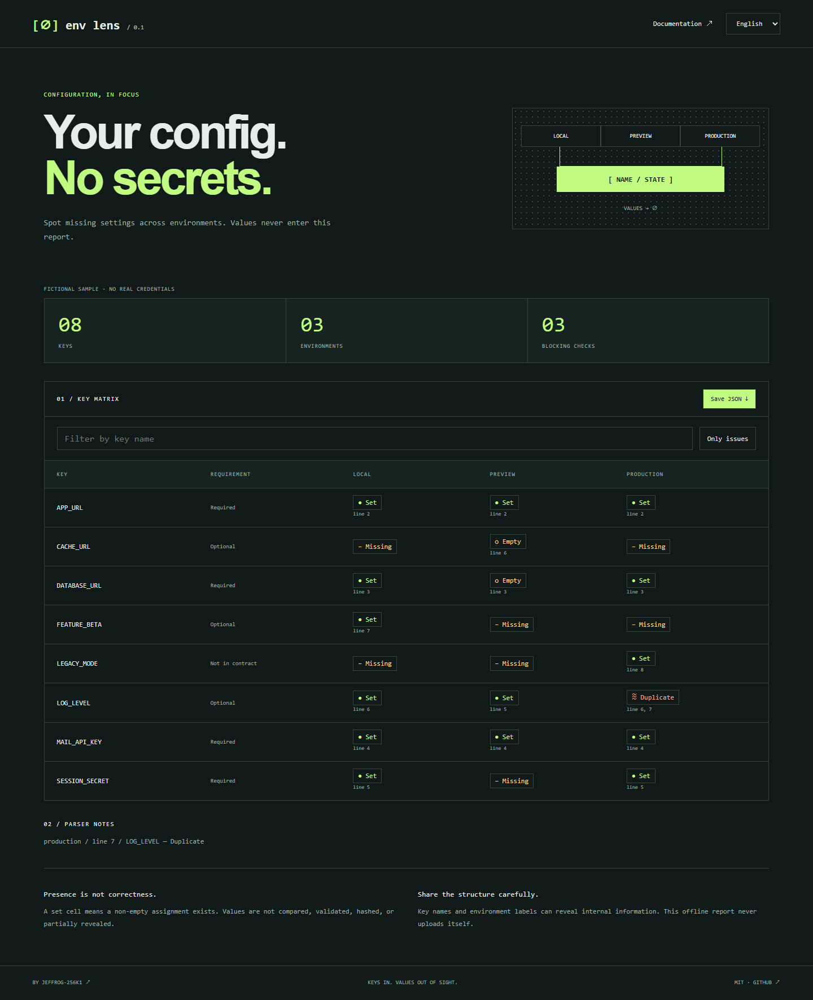

# Env Lens

[English](README.md) · [한국어](README.ko.md) · [简体中文](README.zh-CN.md) · [日本語](README.ja.md) · [Español](README.es.md)

환경별로 빠진 설정을 찾되 실제 값은 보고서에 넣지 않습니다. 키 목록 계약과 최대 3개의 파일을 로컬 CLI로 검사해 오프라인 비교 보고서를 만듭니다.

[사용해 보기](https://jeffrog-256k1.github.io/env-lens/) · [MIT](LICENSE) · [Changelog](CHANGELOG.md)



## 로컬 실행

Node.js 22.12+ · npm

```sh
git clone https://github.com/jeffrog-256k1/env-lens.git
cd env-lens
npm ci
npm run check -- --contract examples/contract.json --env local=examples/local.env.sample --env preview=examples/preview.env.sample --out reports/review
# Static fictional demo:
npm run build
npm run dev
```

예제는 필수 값이 비어 있거나 없어 의도적으로 **종료 코드 1**을 반환합니다. reports/review/index.html을 직접 열면 됩니다. report.json에도 값 없는 결과가 저장됩니다. --out을 생략하면 JSON을 표준 출력으로 내보냅니다. 기존 출력 폴더는 덮어쓰지 않으므로 매번 새 폴더를 지정하세요. 데모: http://127.0.0.1:4319.

## 동작 방식

required와 optional에 키를 선언하고 --env 이름=경로를 1~3번 지정합니다. 설정됨·빈 값·누락·중복·형식 오류를 구분하며 키 검색과 문제만 보기 기능을 제공합니다. --lang은 en, ko, zh-CN, ja, es를 지원하고 보고서에서도 언어를 바꿀 수 있습니다.

종료 코드 **0**: 차단 항목 없음. **1**: 필수 키의 빈 값/누락, 중복 또는 구문 오류. **2**: 인수·입력·계약·출력 오류. 계약 밖 키는 경고이며 선택 키의 빈 값/누락은 차단하지 않습니다. 값의 일치 여부·유효성을 검사하거나 해시·일부 값을 공개하지 않습니다.

```json
{ "version": 1, "required": ["APP_URL", "SESSION_SECRET"], "optional": ["LOG_LEVEL"] }
```

## 지원 범위와 한계

직접 지정한 UTF-8 일반 파일만 읽습니다. 파일별 64 KiB, 계약과 입력 전체의 고유 키 200개, 환경 3개까지 지원합니다. 키는 영문·숫자·밑줄이며 숫자로 시작할 수 없습니다. 환경 이름은 영문·숫자·밑줄·하이픈 32자까지입니다. 계약 필드는 version, required, optional만 허용합니다.

KEY=value, export 접두사, 빈 줄, # 주석, **한 줄**의 작은따옴표/큰따옴표, 뒤쪽 주석을 지원합니다. 따옴표 안 #은 문자입니다. 큰따옴표의 역슬래시 이스케이프를 읽으며 이스케이프 n/r/t와 공백뿐인 값은 빈 값으로 판단합니다. 변수 치환이나 명령 실행은 하지 않습니다. 중복은 항상 오류입니다. 닫히지 않은 따옴표·여러 줄 값은 오류로 처리하고 **나머지 줄 분석을 중단**합니다. 완전한 dotenv/프레임워크 로더는 아닙니다.

키 이름·환경 이름·줄 번호는 남으므로 공유 전 확인하세요. 예제는 가상 데이터입니다. 업로드 서비스, 클라우드 동기화, 값 비교, 비밀 저장소 기능은 없습니다.

## 개발

```sh
npm test
npm run build
npx playwright install chromium
npm run test:browser
npm run format:check
```

[Contributing](CONTRIBUTING.md) · [Security](SECURITY.md) · [Dependencies](THIRD_PARTY_NOTICES.md)

Built by [jeffrog-256k1](https://github.com/jeffrog-256k1) · [leejungjae.app](https://leejungjae.app)
